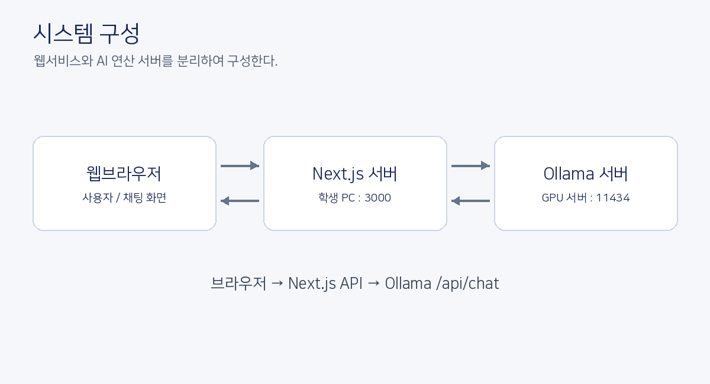
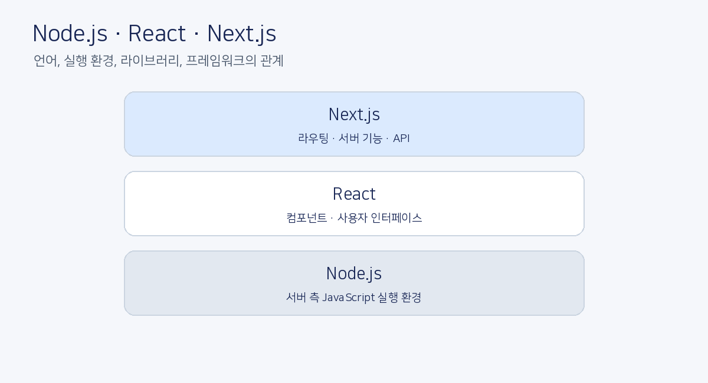
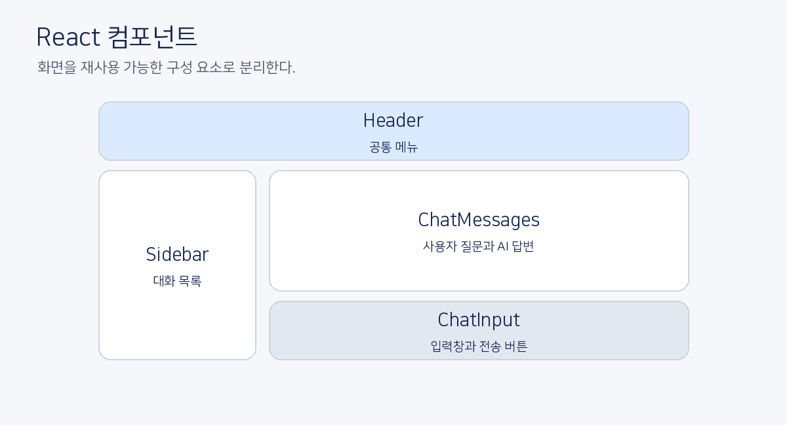
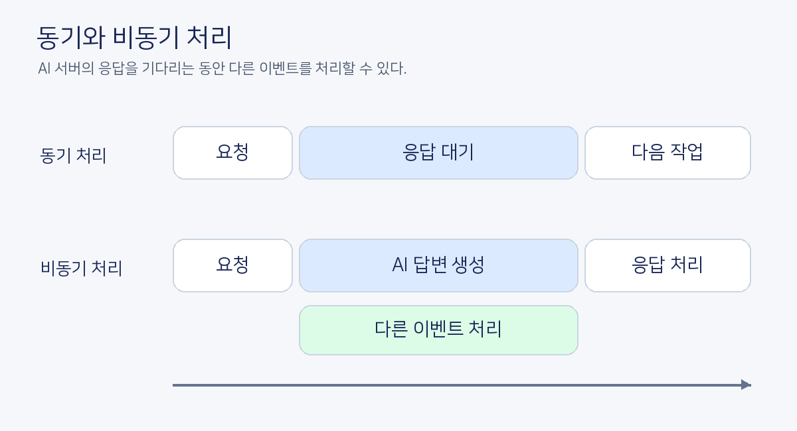
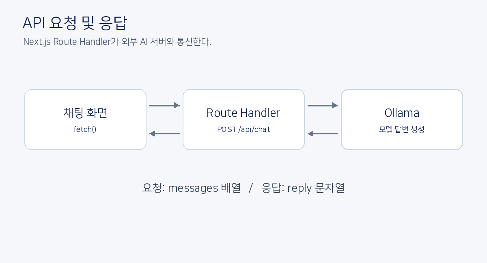
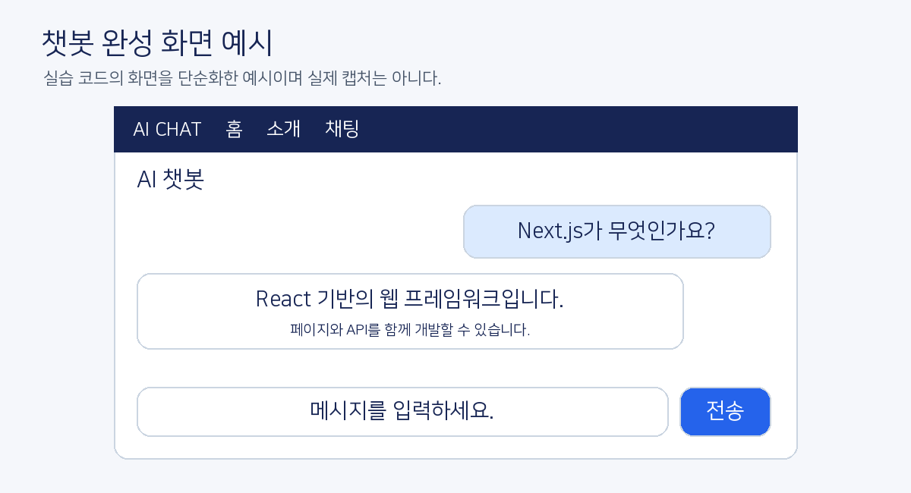
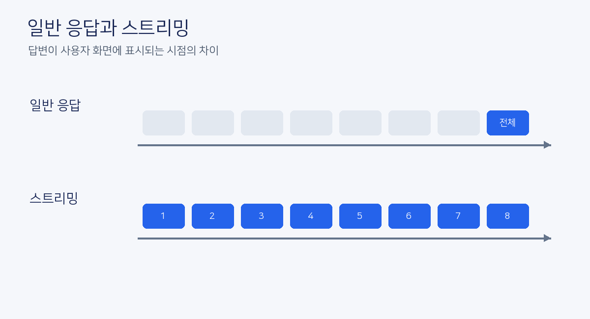

# Next.js 기반 AI 챗봇 웹서비스 개발

웹프로그래밍 실습 자료 | JavaScript · React · Next.js · Ollama

## 1. 실습 목표

이번 실습에서는 Next.js로 웹페이지와 API 서버를 개발하고, 별도의 컴퓨터에서 실행 중인 Ollama에 질문을 전달하여 AI 챗봇을 완성한다. 기존 Flask 및 Django 실습에서 배운 URL, HTTP, 서버의 개념을 바탕으로 진행한다.



학생 PC에는 AI 모델을 설치하지 않는다. 학교 내부망의 GPU 서버를 이용한다. 본 교재의 IP 주소와 모델은 실습용 설정 예시이며 강사가 실제 접속 가능 여부를 확인한 후 사용한다.

## 2. Node.js, React, Next.js

JavaScript는 웹브라우저에서 버튼 클릭, 입력 처리 등의 기능을 구현하는 언어이다. Node.js는 JavaScript를 브라우저 밖에서도 실행할 수 있게 해 주는 실행 환경이다. 따라서 JavaScript로 서버를 실행하고 파일을 읽거나 외부 API를 호출할 수 있다.

React는 사용자 인터페이스를 만들기 위한 라이브러리이다. 화면을 여러 개의 컴포넌트(재사용 가능한 화면 구성 요소)로 나누어 작성한다. Next.js는 React를 기반으로 페이지 이동, 서버 렌더링, API 처리 등의 기능을 제공하는 웹 프레임워크이다.



| 구분 | Flask | Django | Next.js |
|---|---|---|---|
| 언어 | Python | Python | JavaScript / TypeScript |
| 실행 환경 | Python | Python | Node.js |
| 화면 구성 | Jinja2 | Django Template | React / JSX |
| URL 설정 | 데코레이터 | urls.py | 파일 및 폴더 구조 |
| API 개발 | 가능 | 가능 | Route Handler |
| ORM | 별도 연동 | 기본 제공 | 별도 연동 |

## 3. 개발 환경 구축

Windows와 Visual Studio Code를 기준으로 진행한다. [Node.js 공식 홈페이지](https://nodejs.org/)에서 지원 중인 LTS 버전을 설치한다. 설치 후 VS Code를 다시 실행하고 터미널에서 확인한다.

```powershell
node -v
npm -v
```

npm은 JavaScript 패키지를 설치하고 관리하는 도구이다. Python의 pip와 비슷한 역할을 한다. npx는 패키지에 포함된 실행 명령을 실행하는 도구이다.

```powershell
npx create-next-app@latest ai-chatbot --js --eslint --no-tailwind --no-src-dir --app --use-npm
```

추가 질문이 나오면 React Compiler는 No, 기본 import alias는 유지한다. 설치 버전에 따라 질문이 다를 수 있다. PowerShell 실행 정책 오류가 발생하면 CMD를 사용하거나 `npx.cmd`로 실행한다.

```powershell
cd ai-chatbot
npm run dev
```

브라우저에서 http://localhost:3000 으로 접속한다. 서버가 안내한 포트가 다르면 해당 포트를 사용한다. 종료는 Ctrl+C이다.

| 명령 | 기능 |
|---|---|
| npm install | 의존성 설치 |
| npm run dev | 개발 서버 실행 |
| npm run build | 배포용 빌드 |
| npm run start | 빌드된 서버 실행 |

## 4. 프로젝트 구조

```text
ai-chatbot/
  app/
    page.js
    layout.js
    globals.css
  public/
  node_modules/
  package.json
  package-lock.json
  .gitignore
  next.config.mjs
```

`app`은 페이지와 API를 작성하는 폴더이다. `page.js`는 페이지 화면, `layout.js`는 공통 레이아웃, `globals.css`는 공통 스타일을 정의한다. `public`에는 이미지 등 정적 파일을 저장한다. `package.json`에는 의존성과 실행 명령이 정의되며, `package-lock.json`에는 설치된 의존성 버전 정보가 기록된다. `node_modules`는 Git에 올리지 않는다. 다른 PC에서는 `npm install` 또는 lock 파일이 있는 경우 `npm ci`로 복원할 수 있다.

## 5. 첫 번째 페이지 작성

`app/page.js`의 내용을 다음과 같이 변경한다.

```jsx
export default function Home() {
    const title = "AI 챗봇 서비스";
    return (
        <main>
            <h1>{title}</h1>
            <p>Next.js로 만든 첫 번째 웹페이지입니다.</p>
            <button>채팅 시작하기</button>
        </main>
    );
}
```

저장 후 브라우저에서 변경된 화면을 확인한다. 현재 버튼에는 동작을 정의하지 않았으므로 클릭해도 아무 일이 발생하지 않는다.

### JSX

JavaScript 함수 안에서 HTML과 비슷한 문법을 사용하는 것을 JSX라고 한다. 중괄호 안에는 JavaScript 표현식을 넣을 수 있다. `export default`는 파일의 기본 내보내기를 지정하며, Next.js는 page.js의 기본 컴포넌트를 페이지로 사용한다.

| HTML | JSX |
|---|---|
| class="box" | className="box" |
| `<input>` | `<input />` |
| onclick | onClick |

## 6. 페이지 이동과 공통 레이아웃

Next.js App Router에서는 폴더 구조가 URL을 결정한다.

```text
app/
  page.js          -> /
  about/page.js    -> /about
  chat/page.js     -> /chat
```

`app/about/page.js`를 작성한다.

```jsx
export default function About() {
    return <main><h1>서비스 소개</h1><p>Ollama 기반 챗봇입니다.</p></main>;
}
```

`app/chat/page.js`를 작성한다.

```jsx
export default function Chat() {
    return <main><h1>AI 채팅</h1><input placeholder="질문을 입력하세요" /><button>전송</button></main>;
}
```

`app/page.js`를 변경한다.

```jsx
import Link from "next/link";
export default function Home() {
    return <main><h1>AI 챗봇 서비스</h1><Link href="/about">소개</Link><br /><Link href="/chat">채팅 시작하기</Link></main>;
}
```

Link는 Next.js 내부 페이지 이동을 지원한다. `app/layout.js`를 다음과 같이 변경한다. children은 현재 접속한 페이지의 내용이다.

```jsx
import Link from "next/link";
import "./globals.css";
export const metadata = { title: "AI CHAT" };
export default function RootLayout({ children }) {
    return (
        <html lang="ko"><body>
            <header><h2>AI CHAT</h2><nav>
                <Link href="/">홈</Link>
                <Link href="/about">소개</Link>
                <Link href="/chat">채팅</Link>
            </nav></header>
            {children}
            <footer>Next.js AI Chat Project</footer>
        </body></html>
    );
}
```

`app/globals.css`의 기존 내용을 교체한다.

```css
* { box-sizing: border-box; }
body { margin: 0; font-family: Arial, sans-serif; background: #f4f6f9; color: #222; }
header { display: flex; justify-content: space-between; align-items: center; background: #172554; color: white; padding: 15px 24px; }
nav a { color: white; margin-left: 16px; text-decoration: none; }
main { max-width: 900px; margin: 30px auto; padding: 24px; }
button { padding: 10px 18px; border: 0; border-radius: 6px; background: #2563eb; color: white; cursor: pointer; }
input { padding: 10px; border: 1px solid #ccc; border-radius: 6px; }
footer { text-align: center; color: #777; padding: 20px; }
```

이미지를 사용하려면 `public/images/logo.png`에 실제 파일을 저장하고 ``로 불러온다. URL에 public은 포함하지 않는다.

## 7. React 컴포넌트와 Props



프로젝트 최상위에 `components/Welcome.js`를 작성한다.

```jsx
export default function Welcome({ name }) {
    return <h2>{name}님 환영합니다.</h2>;
}
```

`app/page.js`를 수정한다.

```jsx
import Welcome from "../components/Welcome";
import Link from "next/link";
export default function Home() {
    return <main><Welcome name="홍길동" /><Welcome name="김철수" /><Link href="/chat">채팅 시작하기</Link></main>;
}
```

Props는 부모 컴포넌트에서 자식 컴포넌트로 전달하는 값이다. 함수의 매개변수와 비슷하다.

## 8. State와 이벤트

State는 화면에 반영되는 상태 데이터이다. `useState`는 현재 값과 상태를 변경하는 함수를 반환한다. `app/chat/page.js`를 다음 코드로 교체한다.

```jsx
"use client";
import { useState } from "react";
export default function Chat() {
    const [count, setCount] = useState(0);
    return <main><h1>현재 숫자: {count}</h1>
        <button onClick={() => setCount(count + 1)}>증가</button>
        <button onClick={() => setCount(count - 1)}>감소</button>
        <button onClick={() => setCount(0)}>초기화</button>
    </main>;
}
```

입력창 실습을 진행한다. 같은 파일을 교체한다.

```jsx
"use client";
import { useState } from "react";
export default function Chat() {
    const [message, setMessage] = useState("");
    return <main><h1>입력 실습</h1>
        <input value={message} onChange={(e) => setMessage(e.target.value)} />
        <p>입력한 내용: {message}</p>
    </main>;
}
```

입력할 때 onChange 이벤트가 발생하며, e.target.value를 통해 현재 입력값을 얻는다. 상태가 바뀌면 React가 화면을 다시 렌더링한다.

## 9. Server Component와 Client Component

App Router의 페이지와 레이아웃은 기본적으로 Server Component이다. 서버에서 데이터를 조회하거나 화면을 구성할 때 사용한다. 입력창, 클릭 이벤트, useState와 같은 브라우저 상호작용에는 Client Component가 필요하다. 파일 상단에 `"use client";`를 작성한다. Client Component도 초기 HTML이 서버에서 렌더링될 수 있으므로 브라우저에서만 실행된다는 뜻은 아니다.

| 구분 | Server Component | Client Component |
|---|---|---|
| 서버 비공개 환경변수 | 사용 가능 | 직접 접근 불가 |
| useState / onClick | 사용 불가 | 사용 가능 |
| 역할 | 서버 데이터 조회, 화면 구성 | 사용자 입력, 상태 관리 |

이번 실습에서는 채팅 UI를 Client Component로 작성하고, Ollama 통신은 서버의 Route Handler에서 처리한다.

## 10. HTTP와 JSON, API

API는 프로그램 간에 기능을 이용하는 방법을 정의한 인터페이스이다. HTTP API에서는 URL과 요청 방식, 요청 및 응답 데이터 형식을 정한다.

| 방식 | 용도 |
|---|---|
| GET | 조회 |
| POST | 데이터 전달 및 처리 요청 |
| PUT | 전체 수정 |
| PATCH | 일부 수정 |
| DELETE | 삭제 |

JSON은 데이터를 교환하는 문자열 형식이다. JavaScript 객체를 JSON 문자열로 변환하려면 JSON.stringify(), 역변환에는 JSON.parse()를 사용한다.

```javascript
const data = { name: "홍길동" };
const text = JSON.stringify(data);
console.log(JSON.parse(text).name);
```

## 11. Next.js API 개발

`app/api/hello/route.js`를 생성한다. page.js는 화면을, route.js는 HTTP 요청을 처리한다.

```javascript
export function GET() {
    return Response.json({ message: "GET 요청 성공" });
}
export async function POST(request) {
    const data = await request.json();
    return Response.json({ message: data.name + "님 환영합니다!" });
}
```

브라우저에서 http://localhost:3000/api/hello 를 열어 GET 응답을 확인한다. POST 요청은 PowerShell에서 테스트한다.

```powershell
$body = @{ name = "홍길동" } | ConvertTo-Json
Invoke-RestMethod -Uri "http://localhost:3000/api/hello" -Method Post -ContentType "application/json; charset=utf-8" -Body ([System.Text.Encoding]::UTF8.GetBytes($body))
```

브라우저 개발자 도구(F12)의 Console에서도 다음 코드를 실행한다.

```javascript
fetch("/api/hello").then(r => r.json()).then(console.log);
```

## 12. 동기와 비동기

동기적으로 실행되는 코드는 앞의 작업을 마친 뒤 다음 작업을 실행한다. 비동기 처리를 이용하면 네트워크 응답을 기다리는 동안 다른 이벤트나 요청을 처리할 수 있다. AI 응답은 시간이 걸리므로 비동기 요청을 사용한다.



```javascript
console.log("작업 시작");
setTimeout(() => console.log("AI 응답 완료"), 3000);
console.log("다른 작업 실행");
```

출력 순서는 작업 시작 → 다른 작업 실행 → AI 응답 완료이다.

```javascript
async function getData() {
    const response = await fetch("/api/hello");
    const data = await response.json();
    console.log(data.message);
}
getData();
```

async 함수는 Promise를 반환한다. await는 해당 함수의 실행을 기다리게 하지만 브라우저 전체를 멈추게 하지 않는다. fetch는 HTTP 요청을 전송하며, HTTP 오류 상태도 반환할 수 있으므로 response.ok를 확인한다.

## 13. Ollama 서버 연결

LLM은 대규모 언어 모델이다. Ollama는 LLM을 실행하고 API로 제공하는 프로그램이며, Qwen3는 실제 답변을 생성하는 모델이다.

| 설정 | 실습 예시 |
|---|---|
| 서버 | 192.168.5.224 |
| 포트 | 11434 |
| 모델 | qwen3:8b |
| 모델 조회 | GET /api/tags |
| 채팅 | POST /api/chat |

### 강사 준비사항

학교에서 승인된 내부 네트워크에서만 접속을 허용한다. Ollama API는 기본적으로 로컬 인증을 제공하지 않으므로 인터넷에 직접 노출하지 않는다. 이미 접속 가능하면 아래 설정은 생략한다. Ubuntu의 systemd 설치 환경에서 다음 설정을 확인한다.

```bash
sudo systemctl edit ollama
```

```ini
[Service]
Environment="OLLAMA_HOST=0.0.0.0:11434"
```

```bash
sudo systemctl daemon-reload
sudo systemctl restart ollama
sudo systemctl status ollama
ollama list
```

필요한 모델이 없다면 강사가 `ollama pull qwen3:8b`로 설치한다. 방화벽에서 허용된 실습망만 접근하도록 제한한다.

### 학생 PC 연결 테스트

브라우저에서 `http://192.168.5.224:11434/api/tags`에 접속하여 모델 목록을 확인한다.

```powershell
Test-NetConnection 192.168.5.224 -Port 11434
```

TcpTestSucceeded가 True이면 포트에 연결할 수 있다. 다음으로 실제 질문을 전송한다.

```powershell
$body = @{
    model = "qwen3:8b"
    messages = @(@{ role = "user"; content = "Next.js가 무엇인지 설명해줘." })
    stream = $false
} | ConvertTo-Json -Depth 5
$result = Invoke-RestMethod -Uri "http://192.168.5.224:11434/api/chat" -Method Post -ContentType "application/json; charset=utf-8" -Body ([System.Text.Encoding]::UTF8.GetBytes($body))
$result.message.content
```

Ollama에 전달하는 JSON의 model은 모델 이름, messages는 대화 배열, stream은 응답을 나누어 전달할지 결정하는 값이다. 응답의 message.content에 답변이 들어 있다.

## 14. Next.js에서 Ollama 호출

프로젝트 최상위에 `.env.local`을 만든다.

```ini
OLLAMA_URL=http://192.168.5.224:11434
OLLAMA_MODEL=qwen3:8b
```

서버를 재시작한다. 환경변수는 서버 설정을 소스코드와 분리하기 위해 사용한다. 이 파일을 Git에 올리지 않으며 NEXT_PUBLIC_ 접두사를 사용하지 않는다.



`app/api/chat/route.js`를 생성한다. 우선 한 번의 질문을 처리한다.

```javascript
export async function POST(request) {
    try {
        const { message } = await request.json();
        if (typeof message !== "string" || !message.trim()) {
            return Response.json({ error: "메시지를 입력하세요." }, { status: 400 });
        }
        const response = await fetch(`${process.env.OLLAMA_URL}/api/chat`, {
            method: "POST",
            headers: { "Content-Type": "application/json" },
            body: JSON.stringify({
                model: process.env.OLLAMA_MODEL,
                messages: [{ role: "user", content: message }],
                stream: false
            }),
            signal: AbortSignal.timeout(120000)
        });
        if (!response.ok) throw new Error(`Ollama HTTP ${response.status}`);
        const data = await response.json();
        return Response.json({ reply: data.message.content });
    } catch (error) {
        console.error(error);
        return Response.json({ error: "AI 서버 연결 오류" }, { status: 502 });
    }
}
```

try/catch는 오류가 발생했을 때 프로그램이 적절한 응답을 반환하도록 한다. AbortSignal.timeout은 요청 제한 시간을 밀리초로 지정한다.

```powershell
$body = @{ message = "안녕하세요" } | ConvertTo-Json
Invoke-RestMethod -Uri "http://localhost:3000/api/chat" -Method Post -ContentType "application/json; charset=utf-8" -Body ([System.Text.Encoding]::UTF8.GetBytes($body))
```

## 15. 첫 번째 챗봇 화면

`app/chat/page.js`를 교체한다.

```jsx
"use client";
import { useState } from "react";
export default function Chat() {
    const [message, setMessage] = useState("");
    const [reply, setReply] = useState("");
    const [loading, setLoading] = useState(false);
    async function sendMessage() {
        if (!message.trim() || loading) return;
        setLoading(true);
        setReply("");
        try {
            const response = await fetch("/api/chat", {
                method: "POST",
                headers: { "Content-Type": "application/json" },
                body: JSON.stringify({ message })
            });
            const data = await response.json();
            if (!response.ok) throw new Error(data.error);
            setReply(data.reply);
        } catch (error) {
            setReply("오류: " + error.message);
        } finally {
            setLoading(false);
        }
    }
    return <main><h1>AI 챗봇</h1>
        <input value={message} onChange={e => setMessage(e.target.value)} placeholder="질문 입력" />
        <button onClick={sendMessage} disabled={loading}>{loading ? "답변 생성 중" : "전송"}</button>
        <p style={{ whiteSpace: "pre-wrap" }}>{reply}</p>
    </main>;
}
```

질문을 입력하고 전송 버튼을 누른다. 응답을 기다리는 동안 버튼이 비활성화되며, 응답이 완료되면 AI 답변이 표시된다. finally는 성공 여부와 상관없이 실행된다.

## 16. 대화 기록과 문맥

AI가 이전 대화를 참고하려면 이전 질문과 답변을 함께 전송해야 한다. 화면에 기록만 표시한다고 AI가 기억하는 것은 아니다.

```javascript
const messages = [
    { role: "user", content: "내 이름은 홍길동이야." },
    { role: "assistant", content: "안녕하세요, 홍길동님!" },
    { role: "user", content: "내 이름은 뭐지?" }
];
```

role은 user(사용자), assistant(AI), system(기본 지시사항)으로 구분된다. 배열의 map()은 요소마다 화면을 생성하는 데 사용한다. 전개 연산자 `...`는 기존 배열을 펼쳐 새로운 배열을 만든다.

```javascript
const newMessages = [...messages, { role: "user", content: "새 질문" }];
```

## 17. 최종 백엔드 코드

이제 요청 형식을 message에서 messages 배열로 바꾼다. 다음 절의 프론트엔드도 함께 변경해야 한다. `app/api/chat/route.js` 전체를 교체한다.

```javascript
export async function POST(request) {
    let body;
    try { body = await request.json(); }
    catch { return Response.json({ error: "잘못된 JSON" }, { status: 400 }); }
    const messages = body?.messages;
    if (!Array.isArray(messages) || messages.length === 0 || messages.length > 21 ||
        !messages.every(m => m && ["user", "assistant"].includes(m.role) &&
            typeof m.content === "string" && m.content.trim() && m.content.length <= 16000) ||
        messages.at(-1).role !== "user" || messages.at(-1).content.length > 4000) {
        return Response.json({ error: "잘못된 대화 내용" }, { status: 400 });
    }
    try {
        const response = await fetch(`${process.env.OLLAMA_URL}/api/chat`, {
            method: "POST",
            headers: { "Content-Type": "application/json" },
            body: JSON.stringify({
                model: process.env.OLLAMA_MODEL,
                messages: [
                    { role: "system", content: "학생의 학습을 돕는 AI입니다. 한국어로 쉽게 설명하세요." },
                    ...messages
                ],
                stream: false,
                options: { temperature: 0.7, num_predict: 1024 }
            }),
            signal: AbortSignal.timeout(120000)
        });
        if (!response.ok) throw new Error(`Ollama HTTP ${response.status}`);
        const data = await response.json();
        if (typeof data.message?.content !== "string" || !data.message.content.trim()) {
            throw new Error("빈 응답 또는 잘못된 응답");
        }
        return Response.json({ reply: data.message.content });
    } catch (error) {
        console.error(error);
        return Response.json({ error: "AI 서버 응답 오류. 잠시 후 다시 시도하세요." }, { status: 502 });
    }
}
```

최근 대화만 보내고 출력 토큰 수를 제한하여 실습 서버의 부하를 줄인다. 실제 서비스에서는 모델의 컨텍스트 길이에 맞춘 토큰 단위 제한과 인증, 요청 빈도 제한이 필요하다. 추론 모델은 생각 과정에 생성 토큰을 사용하여 답변이 비어 있을 수도 있다. 이 경우 모델 설정이나 생성 토큰 한도를 강사와 확인한다.

## 18. 최종 프론트엔드 코드

`app/chat/page.js` 전체를 교체한다.

```jsx
"use client";
import { useState } from "react";
export default function Chat() {
    const [messages, setMessages] = useState([]);
    const [input, setInput] = useState("");
    const [loading, setLoading] = useState(false);
    const [error, setError] = useState("");
    async function sendMessage(e) {
        e.preventDefault();
        if (!input.trim() || loading) return;
        const userMessage = { role: "user", content: input.trim() };
        const next = [...messages, userMessage];
        setMessages(next);
        setInput("");
        setError("");
        setLoading(true);
        try {
            const response = await fetch("/api/chat", {
                method: "POST",
                headers: { "Content-Type": "application/json" },
                body: JSON.stringify({ messages: next.slice(-21) })
            });
            const data = await response.json();
            if (!response.ok) throw new Error(data.error || "요청 실패");
            setMessages([...next, { role: "assistant", content: data.reply }]);
        } catch (err) {
            setMessages(messages);
            setInput(userMessage.content);
            setError(err.message);
        } finally {
            setLoading(false);
        }
    }
    function clearChat() {
        setMessages([]); setInput(""); setError("");
    }
    return (
        <main className="chat-container">
            <div className="chat-header"><div><h1>AI 챗봇</h1><p>Ollama 기반 AI 서비스</p></div>
                <button onClick={clearChat} disabled={loading}>새로운 채팅</button>
            </div>
            <div className="chat-messages" aria-live="polite">
                {messages.length === 0 && <div className="welcome">무엇을 도와드릴까요?</div>}
                {messages.map((msg, index) => (
                    <div key={index} className={`message-row ${msg.role}`}>
                        <div className="message-bubble"><strong>{msg.role === "user" ? "나" : "AI Assistant"}</strong><p>{msg.content}</p></div>
                    </div>
                ))}
                {loading && <p>AI가 답변을 생성하고 있습니다...</p>}
            </div>
            {error && <p className="chat-error" role="alert">{error}</p>}
            <form className="chat-input" onSubmit={sendMessage}>
                <input aria-label="메시지" value={input} onChange={e => setInput(e.target.value)} placeholder="메시지를 입력하세요" maxLength={4000} disabled={loading} />
                <button type="submit" disabled={loading || !input.trim()}>전송</button>
            </form>
            <p className="notice">AI의 답변은 정확하지 않을 수 있습니다.</p>
        </main>
    );
}
```

form을 사용하면 Enter로 전송할 수 있다. preventDefault()는 기본 페이지 새로고침을 방지한다. 요청에 실패하면 기존 대화와 입력값을 복원한다. 대화 기록은 현재 페이지의 상태에만 저장되며 새로고침하면 사라진다.

## 19. 최종 화면 디자인

`app/globals.css`의 마지막에 다음 내용을 추가한다.

```css
.chat-container { background: white; border-radius: 16px; box-shadow: 0 4px 20px #00000010; }
.chat-header { display: flex; justify-content: space-between; align-items: center; border-bottom: 1px solid #e5e7eb; padding-bottom: 16px; }
.chat-header h1 { margin: 0; font-size: 24px; }
.chat-header p { color: #64748b; }
.chat-messages { height: 480px; overflow-y: auto; padding: 20px 0; }
.welcome { text-align: center; color: #64748b; padding-top: 150px; }
.message-row { display: flex; margin-bottom: 16px; }
.message-row.user { justify-content: flex-end; }
.message-bubble { max-width: 85%; padding: 14px 18px; border-radius: 14px; overflow-wrap: anywhere; line-height: 1.7; }
.message-bubble p { margin: 6px 0 0; white-space: pre-wrap; }
.user .message-bubble { background: #2563eb; color: white; }
.assistant .message-bubble { background: #f1f5f9; color: #1e293b; }
.chat-input { display: flex; gap: 10px; border-top: 1px solid #e5e7eb; padding-top: 16px; }
.chat-input input { flex: 1; min-width: 0; }
button:disabled { opacity: .5; cursor: not-allowed; }
.chat-error { color: #b91c1c; }
.notice { text-align: center; font-size: 12px; color: #64748b; }
@media (max-width: 600px) {
    header { flex-wrap: wrap; }
    .chat-container { margin: 10px; padding: 16px; }
    .chat-messages { height: 55vh; }
}
```



## 20. 스트리밍과 WebSocket

현재 프로젝트는 stream: false를 사용하여 답변이 완성된 뒤 한 번에 표시한다. 스트리밍은 답변을 생성하면서 작은 단위로 전송하는 방식이다.



Ollama에서 stream: true를 사용하면 NDJSON 형태의 응답 스트림을 받는다. 설정값만 변경하면 기존 response.json() 코드에서 오류가 발생한다. 백엔드에서 스트림을 전달하고 프론트엔드에서는 ReadableStream과 TextDecoder를 이용하여 줄 단위 JSON을 처리해야 한다. 네트워크 청크와 JSON 한 줄이 반드시 일치하지 않으므로 버퍼링도 필요하다.

| 기술 | 특징 | 예시 |
|---|---|---|
| 일반 HTTP | 요청 후 응답 | 게시판 조회 |
| HTTP Streaming | 응답을 나누어 전달 | AI 답변 |
| SSE | 서버에서 클라이언트로 이벤트 전송 | 알림 |
| WebSocket | 지속적인 양방향 통신 | 사용자 간 실시간 채팅 |

AI 챗봇에는 WebSocket이 반드시 필요한 것은 아니다. 이번 기본 실습에서는 일반 HTTP 응답까지 구현한다.

## 21. 최종 구조 및 실행 확인

```text
ai-chatbot/
  app/
    api/
      hello/route.js
      chat/route.js
    about/page.js
    chat/page.js
    page.js
    layout.js
    globals.css
  components/Welcome.js
  public/
  .env.local
  package.json
```

- `/` : 메인 페이지
- `/about` : 소개 페이지
- `/chat` : 챗봇 화면
- `/api/hello` : GET/POST 테스트
- `/api/chat` : POST 채팅 요청

다음 순서로 확인한다.

1. Ollama 모델 목록 조회
2. Ollama API 직접 호출
3. Next.js API 요청 확인
4. 브라우저에서 질문 전송 및 답변 확인
5. 이름을 알려준 후 이름을 다시 질문하여 문맥 전달 확인
6. 새로운 채팅 버튼과 오류 처리 확인

## 22. 오류 해결

| 증상 | 확인 사항 |
|---|---|
| node 명령 없음 | Node.js 설치, VS Code 재실행 |
| npm 실행 정책 오류 | CMD 또는 npm.cmd 사용 |
| 404 | 파일 및 폴더 경로 확인 |
| 405 | GET/POST 방식 확인 |
| useState 오류 | use client 선언 확인 |
| Ollama 접속 실패 | IP, 포트, 방화벽 및 서버 실행 상태 확인 |
| Model not found | 설치된 모델 이름 확인 |
| JSON 오류 | stream: false 확인 |
| 환경변수 오류 | .env.local 위치 확인 후 서버 재시작 |
| 응답 지연 | 모델 크기, GPU 사용량, 동시 요청 확인 |
| 응답이 비어 있음 | 추론 모델의 토큰 한도 및 응답 확인 |
| 이전 대화 기억 못함 | messages 배열 및 모델 문맥 길이 확인 |

브라우저 F12의 Console과 Network에서 오류 및 요청 데이터를 확인한다. 서버 측 오류는 VS Code 터미널에서 확인한다.

## 23. 배포 시 고려사항

외부 Render나 Vercel에 Next.js를 배포하면 해당 서버에서 학교의 192.168.x.x 사설 IP로 직접 연결할 수 없다. 학교 승인 하에 내부 App 서버에 배포하거나 인증된 VPN 또는 API 게이트웨이를 사용한다. Ollama 포트를 외부에 직접 공개하지 않는다. 운영 서비스에는 로그인, 요청 빈도 제한, 동시 접속 관리, 개인정보 및 로그 정책이 필요하다.

## 24. 실습 과제

- [ ] 개발 환경 설치 및 서버 실행
- [ ] 메인, 소개, 채팅 페이지 생성
- [ ] 공통 레이아웃 및 페이지 이동 구현
- [ ] 컴포넌트, Props, State 실습
- [ ] GET/POST API 개발
- [ ] Ollama 직접 통신 테스트
- [ ] 챗봇 API 및 UI 구현
- [ ] 대화 문맥 확인 및 오류 처리

기본 기능 완료 후 다음 중 하나 이상을 추가한다.

| 기능 | 관련 개념 |
|---|---|
| 답변 복사 버튼 | Clipboard API |
| 다크모드 | CSS, State |
| 역할 선택 | System Prompt, 허용 목록 |
| 대화 저장 | LocalStorage |
| 응답 시간 및 토큰 표시 | API 응답 분석 |
| Markdown 렌더링 | 외부 라이브러리, 안전한 출력 |
| 스트리밍 응답 | HTTP Streaming |
| 로그인과 DB 저장 | 인증, 데이터베이스 |

## 25. 참고 자료

- [Next.js 공식 문서](https://nextjs.org/docs)
- [React 기초 학습](https://nextjs.org/learn/react-foundations)
- [React 한국어 문서](https://ko.react.dev/)
- [Node.js](https://nodejs.org/)
- [Ollama API](https://docs.ollama.com/api)
- [Ollama Chat API](https://docs.ollama.com/api/chat)

본 자료는 JavaScript, 일반 CSS, App Router를 기준으로 작성하였다. 로그인, DB 및 스트리밍 구현은 심화 과제로 분리하였다. 학교 서버의 실제 상태 및 코드의 전체 실행 결과는 수업 전 확인이 필요하다.
